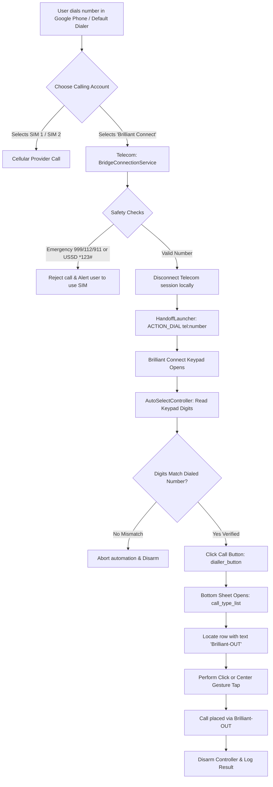

# Brilliant Dialer Bridge

Integrate the Brilliant Connect VoIP app directly into your default Android dialer as a native calling account with automated call dispatch and Brilliant-OUT selection.

-3DDC84?logo=android&logoColor=white)


---

> [!WARNING]
> **Disclaimer**  
> This is an independent, open-source personal utility. It is **not** affiliated with, endorsed by, or sponsored by **InterCloud Limited** or **Brilliant Connect**.  
> This app uses Android's AccessibilityService API solely on your local device to automate UI interactions (pressing the dialer button and selecting the "Brilliant-OUT" option) inside the separately installed Brilliant Connect app.  
> **Brilliant-OUT calls connect to cellular or PSTN telephone networks and are paid calls that consume your Brilliant Connect credit balance.**  
> Use this software at your own risk. It is intended strictly for personal sideload use.
>
> The license applies to this project's source code only. It does not grant any rights to Brilliant Connect or its trademarks, and this project is not affiliated with InterCloud Limited.

---

## Table of Contents

- [Screenshots](#screenshots)
- [Features](#features)
- [How It Works](#how-it-works)
- [Requirements](#requirements)
- [Installation](#installation)
- [First-Time Setup](#first-time-setup)
- [Usage](#usage)
- [Permissions Reference](#permissions-reference)
- [Settings Reference](#settings-reference)
- [Troubleshooting](#troubleshooting)
- [Known Limitations](#known-limitations)
- [Security and Privacy](#security-and-privacy)
- [Tech Stack and Project Structure](#tech-stack-and-project-structure)
- [Building from Source](#building-from-source)
- [Roadmap](#roadmap)
- [Contributing](#contributing)
- [License](#license)
- [Acknowledgements](#acknowledgements)

---

## Screenshots

<!-- TODO: add screenshot of Google Phone dialer showing "Call with" account picker (SIM 1, SIM 2, Brilliant Connect) -->
<!-- TODO: add screenshot of Brilliant Dialer Bridge Home Screen -->
<!-- TODO: add screenshot of 8-Step Setup Checklist -->
<!-- TODO: add screenshot of Test Screen with live execution logs -->
<!-- TODO: add screenshot of System Diagnostics and in-app logs -->

---

## Features

- **Native Calling Account in Dialer:** Registers a system-level Telecom `PhoneAccount` (`CAPABILITY_CALL_PROVIDER`) so "Brilliant Connect" appears in your native dialer's SIM/account selection prompt alongside your cellular carriers.
- **Automated Call Placement:** Hands dialed numbers to Brilliant Connect via an `ACTION_DIAL` intent and automatically engages the in-app green call button.
- **Automatic Brilliant-OUT Selection:** Automatically detects the call-type bottom sheet and selects the "Brilliant-OUT" option, falling back to coordinate-based gesture tapping if standard view click events are consumed by parent containers.
- **Strict Number Safety Verification:** Before pressing the call button, the accessibility engine reads the destination number on the Brilliant Connect keypad and verifies that the last 10 digits match the dialed number. If a mismatch is detected, the automation immediately aborts to prevent dialing the wrong party.
- **Emergency and USSD Guard:** Automatically rejects and bypasses emergency numbers (`999`, `112`, `911`, etc.) and carrier USSD codes (`*123#`, `#121#`), notifying the user to place those calls via their cellular SIM.
- **Zero Internet / Offline Privacy:** The application declares no internet permission (`android.permission.INTERNET` is omitted). No call data, telemetry, or numbers ever leave the local device.
- **Privacy-Safe In-App Logging:** All phone numbers shown in diagnostics and logs are automatically masked (e.g., `017****5678`).
- **Call Redirection Fallback:** Includes an optional `CallRedirectionService` implementation on Android 10+ for OEM dialers that hide third-party calling accounts.

---

## How It Works

1. You dial a number in your default dialer (such as Google Phone) and choose **Brilliant Connect** from the account picker.
2. Android Telecom delegates the outgoing call to `BridgeConnectionService`.
3. `BridgeConnectionService` inspects the number for safety rules (verifying it is not an emergency number or USSD code), triggers the handoff mechanism, and immediately disconnects and destroys the Telecom connection session locally.
4. `HandoffLauncher` launches Brilliant Connect with an `ACTION_DIAL` intent (`tel:<number>`). If background start restrictions apply, it triggers an overlay launch or posts a high-priority notification with a full-screen intent.
5. `AutoSelectController` arms itself for a maximum of 12 seconds.
6. When Brilliant Connect opens, `BrilliantOutAccessibilityService` reads `screen_tab_dialer_editText_number`, verifies that the digits match the dialed number, and clicks the call button (`dialler_button`).
7. When the call type bottom sheet appears (`call_type_list`), the service locates the row labeled **"Brilliant-OUT"** (`sheet_item_text`), executes a click (or a 50ms gesture tap centered on the row bounds), disarms itself, and concludes the handoff.



---

## Requirements

- **Device:** Physical Android device running **Android 8.0 (Oreo / API 26) through Android 15 (API 35)**.
- **Target App:** [Brilliant Connect](https://play.google.com/store/apps/details?id=com.brilliant.connect.com.bd) (`com.brilliant.connect.com.bd`) installed and logged into an active account with sufficient call balance.
- **Dialer:** A dialer app that supports selecting third-party calling accounts (e.g., **Phone by Google** / Google Phone).
- **Computer / Debugging:** USB debugging is only required if installing or building via ADB/Gradle.

---

## Installation

1. Download the release APK file:
   <!-- TODO: add release download link (e.g. https://github.com/<owner>/brilliant-dialer-bridge/releases) -->
2. If installing directly on your Android device, allow installation from unknown sources when prompted by your browser or file manager.
3. Alternatively, install via ADB:
   ```bash
   adb install -r app-debug.apk
   ```
4. Open **Brilliant Dialer Bridge** and complete the first-time setup checklist.

---

## First-Time Setup

Android security requires manual approval for Telecom calling accounts, accessibility services, and overlay permissions. Open the **Setup Checklist** screen in the app and complete these steps once:

1. **Phone and Calling Permissions (`READ_PHONE_STATE`, `CALL_PHONE`):**  
   Tap **Grant Permissions** and approve the system dialog. This allows the app to detect registered calling accounts and manage phone state transitions.
2. **Notifications Permission (`POST_NOTIFICATIONS`):**  
   Required on Android 13+ to show high-priority call launch alerts, call confirmation prompts, and error notices.
3. **Display Over Other Apps (`SYSTEM_ALERT_WINDOW`):**  
   Tap **Grant Overlay Access** and toggle ON for Brilliant Dialer Bridge. This lifts Android 10+ background activity restrictions so Brilliant Connect opens immediately when you place a call from your dialer.
4. **Full-Screen Call Prompts (`USE_FULL_SCREEN_INTENT`):**  
   Allows full-screen notification prompts on Android 14+ if a handoff occurs while the screen is locked or in full-screen mode.
5. **Ignore Battery Optimizations:**  
   Exempts the bridge from aggressive OEM battery management so the Telecom connection service is not terminated during dialing.
6. **Confirm Brilliant Connect Installed:**  
   Verifies that package `com.brilliant.connect.com.bd` is present on the device.
7. **Enable Accessibility Automation:**  
   Tap **Open Accessibility Settings**, locate **Brilliant Dialer Auto-Select**, and toggle it **ON**.  
   *Android 13+ Sideload Notice:* If the toggle is greyed out, go to **Settings → Apps → Brilliant Dialer Bridge**, tap the three-dot menu (⋮) in the top right corner, select **Allow restricted settings**, authenticate, and return to toggle the service ON.
8. **Enable Calling Account in System Settings:**  
   Tap **Open Calling Accounts**. Under your system's calling accounts menu, switch ON **Brilliant Connect**.

---

## Usage

### Placing a Call
1. Open your default phone dialer (e.g., Google Phone).
2. Dial any standard phone number or select a contact.
3. In the calling account picker, choose **Brilliant Connect**.
4. The bridge automatically opens Brilliant Connect, verifies the digits, presses the green call button, and taps **Brilliant-OUT**.

> **Single SIM Devices:** If your phone only has one physical SIM card, Google Phone may bypass the account selection prompt and call directly through the SIM.  
> Open **Google Phone → Settings → Calls → Calling accounts**, confirm **Brilliant Connect** is enabled, and change **Make calls with** to **Always ask**.

### Test Screen
Navigate to **Test Bridge** to safely test the automation flow:
- **Test Handoff Only:** Hands the number to Brilliant Connect and opens the Keypad without pressing the call button.
- **Test Full Auto-Call:** Executes the full flow (hands off, presses call, selects Brilliant-OUT).
- **Safety Simulation:** Simulates the entire sequence in memory with mock delays and node checks without placing any real call.
- **Execution Log:** Shows live step-by-step progress, node detection, and click status.

### Settings Screen
Customize runtime behavior to fit your device:
- **Auto-select Brilliant-OUT:** Toggles whether the bottom sheet row is automatically selected.
- **Sheet Target Label:** Customizes the text to look for in the sheet (defaults to `Brilliant-OUT`).
- **Auto-press Call Button:** Toggles whether the green call button is pressed automatically once digits match.
- **Confirm Before Calling:** When enabled, posts an interactive notification requiring you to tap "Call Now" before the call button is pressed.
- **Number Formatting:** Choose between `As Dialed` (default), `International E.164 (+880...)`, or `Local Format (01...)`.
- **Handoff Strategy:** Select between `ACTION_DIAL` (recommended), `ACTION_VIEW`, or `Launcher + Clipboard Copy`.
- **Route ALL Outgoing Calls:** Optional `CallRedirectionService` fallback for OEM dialers that refuse to display third-party calling accounts.
- **Register on Boot:** Automatically registers the `PhoneAccount` on device boot or app update.

### Diagnostics Screen
- Inspects `PhoneAccount` registration and enablement status.
- Shows your default system dialer package name.
- Lists all registered calling accounts recognized by Android Telecom.
- Reports real-time states of all required permissions and the accessibility service.
- Displays the last auto-select state machine state and reason for any failure.
- In-app circular log viewer with **Copy Logs** and **Clear Logs** buttons.

---

## Permissions Reference

| Permission | Protection Level | Purpose |
|---|---|---|
| `android.permission.READ_PHONE_STATE` | Runtime | Query call-capable phone accounts from `TelecomManager` to verify enablement. |
| `android.permission.CALL_PHONE` | Runtime | Initiates phone call intents and manages connection transitions. |
| `android.permission.POST_NOTIFICATIONS` | Runtime (Android 13+) | Displays high-priority call prompts, call confirmation actions, and error alerts. |
| `android.permission.SYSTEM_ALERT_WINDOW` | Special App Access | Lifts Android 10+ background activity start restrictions to launch Brilliant Connect directly from the dialer. |
| `android.permission.USE_FULL_SCREEN_INTENT` | Normal / Special (Android 14+) | Shows full-screen handoff notifications when the device is locked or running full-screen tasks. |
| `android.permission.REQUEST_IGNORE_BATTERY_OPTIMIZATIONS` | Normal | Prevents background OEM battery managers from killing the bridge connection service during dialing. |
| `android.permission.RECEIVE_BOOT_COMPLETED` | Normal | Re-registers the `PhoneAccount` with `TelecomManager` after device reboot or app update. |
| `android.permission.BIND_TELECOM_CONNECTION_SERVICE` | Signature / System | Protects `BridgeConnectionService`, allowing only the Android Telecom framework to bind to it. |
| `android.permission.BIND_ACCESSIBILITY_SERVICE` | Signature / System | Protects `BrilliantOutAccessibilityService`, allowing only the system accessibility framework to bind to it. |
| `android.permission.BIND_CALL_REDIRECTION_SERVICE` | Signature / System | Protects the optional `BridgeCallRedirectionService` for rerouting calls when enabled. |

> **Note on Internet Access:**  
> The `android.permission.INTERNET` permission is **not requested** in `AndroidManifest.xml`. The app has no network access capabilities.

---

## Settings Reference

| Setting | Type / Options | Default | Description |
|---|---|---|---|
| `autoSelectBrilliantOut` | Boolean | `true` | Automatically taps the Brilliant-OUT row when the call-type bottom sheet appears. |
| `targetOptionLabel` | String | `Brilliant-OUT` | Exact text of the bottom sheet row to click (case-insensitive, trimmed). |
| `autoPressCallButton` | Boolean | `true` | Automatically taps the green dialer button when keypad digits match. When disabled, stops at the keypad. |
| `confirmBeforeCalling` | Boolean | `false` | Displays a notification with a "Call Now" action before pressing the call button. |
| `numberFormat` | `as_dialed` \| `e164` \| `local` | `as_dialed` | Controls destination number format sent to the keypad (`01...`, `+8801...`, or raw dialed digits). |
| `handoffStrategy` | `dial_intent` \| `view_intent` \| `launcher_copy` | `dial_intent` | Intent mechanism used to launch Brilliant Connect. |
| `routeAllOutgoingCalls` | Boolean | `false` | Fallback using `CallRedirectionService` to intercept and reroute all cellular calls via Brilliant Connect. |
| `hasSeenPaidCallWarning` | Boolean | `false` | Tracks whether the one-time paid call warning modal has been acknowledged. |
| `targetPackageName` | String | `com.brilliant.connect.com.bd` | Target package name for Brilliant Connect. |
| `startOnBoot` | Boolean | `true` | Automatically registers the calling account upon receiving `BOOT_COMPLETED` or `MY_PACKAGE_REPLACED`. |

---

## Troubleshooting

| Problem | Cause | Solution |
|---|---|---|
| **Brilliant Connect does not appear when calling; call goes out on cellular SIM** | Single-SIM devices do not show an account picker by default in Google Phone. | Open **Google Phone → Settings → Calls → Calling accounts**. Ensure **Brilliant Connect** is turned ON, then set **Make calls with** to **Always ask**. |
| **Account missing from Calling Accounts settings** | The account has not yet registered with Android Telecom. | Open Brilliant Dialer Bridge once to trigger registration. Verify the account is recognized using `adb shell dumpsys telecom`. |
| **Accessibility service cannot be toggled / is greyed out** | Android 13+ restricted settings security prevents sideloaded apps from enabling accessibility services. | Go to **Settings → Apps → Brilliant Dialer Bridge**, tap the three dots (⋮) in the top-right corner, tap **Allow restricted settings**, authenticate, and return to Accessibility settings to turn it on. |
| **App opens Brilliant Connect but does not press call or pick Brilliant-OUT** | Accessibility service is off, battery optimization killed the service, or an app update changed UI IDs/labels. | 1. Confirm the accessibility service is active.<br>2. Ensure the dialed number matches the keypad.<br>3. Open **Diagnostics** in the bridge app to check the last state and failure reason. |
| **Brilliant Connect does not open from background when dialed** | Background activity launch blocked by Android 10+ restrictions. | Grant **Display over other apps** (`SYSTEM_ALERT_WINDOW`) and **Full-screen intent** permission in the Setup Checklist. |
| **Dialer does not list third-party accounts (Samsung, Xiaomi, Oppo)** | Heavily customized OEM dialers hide third-party `PhoneAccount` entries. | 1. Install **Phone by Google** from the Play Store and set it as default dialer.<br>2. Or enable **Route ALL Outgoing Calls via Brilliant** in Bridge Settings. |
| **Number mismatch / Auto-select did nothing** | Keypad digits in Brilliant Connect did not match the dialed number. | The safety controller refuses to place calls if the last 10 digits differ. Check your number format settings in the bridge app. |
| **Unexpected credit consumption** | Brilliant-OUT connects to cellular/landline networks and incurs charges. | Enable **Confirm before calling** in Settings to require manual confirmation before each automated call. |

---

## Known Limitations

- **OEM Dialer Incompatibility:** While standard Android dialers (Google Pixel, Motorola, Nothing, Sony) display third-party calling accounts, custom OEM dialers (such as Samsung One UI, Xiaomi HyperOS, or Oppo ColorOS) often hide them. Use Google Phone or the Call Redirection fallback on those devices.
- **Target UI ID Dependency:** Automation depends on Brilliant Connect's view IDs (`com.brilliant.connect.com.bd:id/screen_tab_dialer_editText_number`, `com.brilliant.connect.com.bd:id/dialler_button`, `com.brilliant.connect.com.bd:id/call_type_list`, and the text `"Brilliant-OUT"`). If InterCloud changes these resource IDs in an update, the flow will halt at the keypad.
- **Sideload Distribution:** Google Play policies restrict `AccessibilityService` usage for apps that do not provide accessibility functionality to disabled users. This utility is intended for personal sideloading.
- **No Incoming Call Support:** Incoming Brilliant Connect calls are handled natively inside the Brilliant Connect app. This bridge only handles outgoing calls.
- **No iOS Support:** Apple iOS does not provide public APIs for registering third-party calling accounts in the native Phone app or dispatching accessibility gestures between apps.

---

## Security and Privacy

- **No Network Access:** The app does not request `android.permission.INTERNET`. It cannot send data over the internet or communicate with external servers.
- **No Audio Handling:** The bridge never handles, routes, intercepts, or records call audio. Audio is handled entirely by Brilliant Connect.
- **Restricted Accessibility Scope:** `BrilliantOutAccessibilityService` is scoped strictly to `com.brilliant.connect.com.bd` in its service configuration (`android:packageNames="com.brilliant.connect.com.bd"`). It does not receive events from any other application.
- **Minimal View Inspection:** The accessibility controller reads only the keypad EditText and the bottom sheet row labels. It never reads contacts, chats, or other screens.
- **Privacy Masking:** All phone numbers in memory logs and diagnostics are automatically masked (e.g., `+88017****5678`).

---

## Tech Stack and Project Structure

- **Language:** Kotlin 2.2
- **UI Toolkit:** Jetpack Compose with Material Design 3
- **Architecture:** MVVM with Kotlin Coroutines and StateFlow
- **Persistence:** Jetpack DataStore Preferences
- **System APIs:** Android Telecom Framework (`PhoneAccount`, `ConnectionService`, `CallRedirectionService`), `AccessibilityService`

```
app/src/main/java/com/example/
├── BridgeApplication.kt           # Application startup, channel creation, account registration
├── MainActivity.kt                # Single activity, Navigation Compose, onResume status refresh
├── autoselect/
│   ├── AutoSelectController.kt   # State machine, number verification, timeout, click/gesture logic
│   └── BrilliantOutAccessibilityService.kt # Accessibility service bridge & gesture dispatcher
├── data/
│   └── SettingsRepository.kt      # DataStore-backed preference storage
├── handoff/
│   ├── HandoffActionReceiver.kt   # Interactive notification broadcast receiver
│   ├── HandoffLauncher.kt         # Intent resolver, overlay launcher, fallback clipboard handler
│   └── HandoffNotificationManager.kt # Notification channels and full-screen intent builder
├── telecom/
│   ├── BootReceiver.kt            # Re-registers PhoneAccount on boot and package replacement
│   ├── BridgeCallRedirectionService.kt # Optional CallRedirectionService fallback
│   ├── BridgeConnectionService.kt # Outbound ConnectionService implementation
│   └── BridgePhoneAccountManager.kt # PhoneAccount builder and Telecom registration
├── ui/
│   ├── BridgeViewModel.kt         # Central ViewModel managing state and diagnostics
│   ├── screens/
│   │   ├── ChecklistScreen.kt     # 8-step permission and configuration onboarding
│   │   ├── DiagnosticsScreen.kt   # Telecom inspection, calling accounts, log buffer
│   │   ├── HomeScreen.kt          # Main dashboard, readiness status, quick controls
│   │   ├── SettingsScreen.kt      # Formats, toggles, handoff strategy options
│   │   └── TestScreen.kt          # Live execution runner and simulation testing
│   └── theme/
│       ├── Color.kt               # Electric Cyan & Deep Navy palette
│       ├── Theme.kt               # Material 3 dark/light theme definitions
│       └── Type.kt                # Typography configurations
└── util/
    ├── BridgeLogger.kt            # In-memory circular log buffer
    ├── NumberMasker.kt            # Privacy masking utility
    ├── NumberNormalizer.kt        # E.164 and local Bangladesh number normalization
    ├── PermissionHelper.kt        # Setup status inspection helper
    └── SafetyChecker.kt           # Emergency number and USSD filtering
```

---

## Building from Source

### Prerequisites
- JDK 17 or JDK 21
- Android SDK Platform 35 and Build Tools installed
- Gradle 8.x+ (or using the Gradle wrapper)

### Build Commands
1. Clone the repository:
   ```bash
   git clone https://github.com/<owner>/brilliant-dialer-bridge.git
   cd brilliant-dialer-bridge
   ```
2. Build the debug APK:
   ```bash
   ./gradlew assembleDebug
   ```
   The APK will be located at `app/build/outputs/apk/debug/app-debug.apk`.
3. Run local unit and Robolectric tests:
   ```bash
   ./gradlew :app:testDebugUnitTest
   ```

---

## Roadmap

- [ ] Support deep-link calling if InterCloud implements custom URI schemes in Brilliant Connect.
- [ ] Add support for detecting additional third-party dialer applications.
- [ ] Customizable tap delay offsets for lower-end devices with slower bottom sheet animations.
- [ ] Exportable diagnostics reports for troubleshooting UI changes across Brilliant Connect updates.

---

## Contributing

Contributions, bug reports, and suggestions are welcome!
1. Fork the repository.
2. Create a feature branch (`git checkout -b feature/improvement`).
3. Commit your changes (`git commit -m 'Add support for custom gesture delays'`).
4. Push to the branch (`git push origin feature/improvement`).
5. Open a Pull Request.

---

## License

This project is licensed under the MIT License. See the LICENSE file for details.

---

## Acknowledgements

- **Brilliant Connect by InterCloud Limited, Bangladesh:** For providing low-cost VoIP communication services.
- **Android Open Source Project (AOSP):** For the Android Telecom and Accessibility frameworks.

---

## Author

Shohidul Islam Shishir (https://github.com/Shishir-ip)
